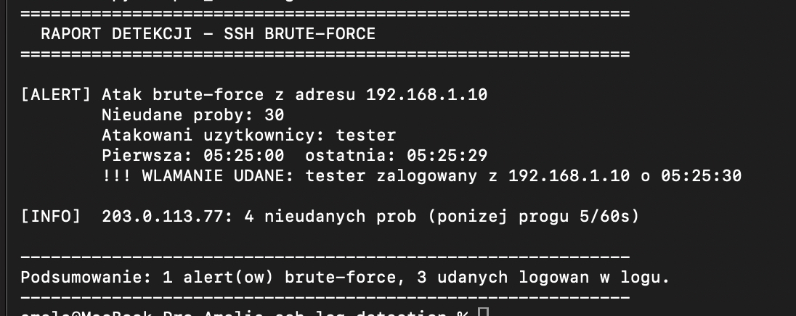
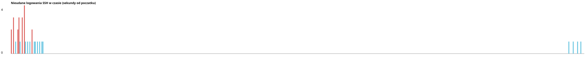

# SSH Log Detection — wykrywanie ataku brute-force w logach

Projekt z obszaru Blue Team / SOC: detekcja ataku słownikowego na SSH na podstawie
logów systemowych `/var/log/auth.log`. Stanowi warstwę **wykrywania** uzupełniającą
projekt [SSH-Brute-Force-Lab](https://github.com/amelia-skoczylas/SSH-Brute-Force-Lab),
w którym atak został przeprowadzony i zablokowany.

Autorka: Amelia Skoczylas

## Cel

Pokazać, jak analityk SOC rozpoznaje atak brute-force w logach: nie na podstawie
pojedynczego błędu logowania, lecz **wzorca** — wielu nieudanych prób z jednego IP
w krótkim czasie, często zakończonych udanym logowaniem (włamaniem).

## Zawartość

| Plik | Opis |
|---|---|
| `detect_bruteforce.py` | Skrypt w Pythonie (bez zależności) analizujący log i zgłaszający alerty |
| `sample_auth.log` | Przykładowy log z atakiem (dane laboratoryjne, zgodne ze środowiskiem projektu SSH) |
| `sigma/ssh_bruteforce.yml` | Reguła detekcji w formacie Sigma (standard używany w SIEM) |
| `alerts.json` | Alerty wyeksportowane do formatu gotowego do integracji z SIEM |
| `timeline.svg` | Wykres nieudanych logowań w czasie (generowany przez skrypt) |

## Logika detekcji

Alert zgłaszany jest, gdy z jednego adresu IP padnie **co najmniej 5 nieudanych
logowań w ciągu 60 sekund**. Dodatkowo skrypt sprawdza, czy po serii nieudanych prób
nastąpiło udane logowanie z tego samego IP — co oznacza skuteczne włamanie.

Te same parametry opisuje reguła `sigma/ssh_bruteforce.yml`, którą można wgrać do
systemu SIEM (np. Wazuh, Splunk, ELK) i uruchomić na realnym strumieniu logów.

## Uruchomienie

```
python3 detect_bruteforce.py sample_auth.log
```

### Przykładowy wynik

```
============================================================
  RAPORT DETEKCJI - SSH BRUTE-FORCE
============================================================

[ALERT] Atak brute-force z adresu 192.168.1.10
        Nieudane proby: 30
        Atakowani uzytkownicy: tester
        Pierwsza: 05:25:00  ostatnia: 05:25:29
        !!! WLAMANIE UDANE: tester zalogowany z 192.168.1.10 o 05:25:30

[INFO]  203.0.113.77: 4 nieudanych prob (ponizej progu 5/60s)

------------------------------------------------------------
Podsumowanie: 1 alert(ow) brute-force, 3 udanych logowan w logu.
------------------------------------------------------------
```

Skrypt poprawnie **nie** alarmuje przy 4 próbach z adresu `203.0.113.77` (poniżej
progu), co ogranicza liczbę fałszywych alarmów — kluczowy aspekt pracy w SOC.



### Wizualizacja ataku w czasie

Skrypt generuje wykres `timeline.svg` — wyraźnie widać skokowy wzrost nieudanych
logowań w trakcie ataku:



### Eksport alertów (`alerts.json`)

Alerty zapisywane są też w formacie JSON, gotowym do przesłania do systemu SIEM
lub do dalszej obróbki:

```json
{
  "severity": "high",
  "src_ip": "192.168.1.10",
  "failed_attempts": 30,
  "targeted_users": ["tester"],
  "successful_breach": true,
  "breach_user": "tester",
  "mitre": "T1110"
}
```

## Wnioski

- Pojedynczy błąd logowania jest normalny; dopiero **gęstość i powtarzalność**
  prób świadczą o ataku.
- Korelacja „seria porażek + sukces z tego samego IP” pozwala odróżnić nieudany
  atak od faktycznego przejęcia konta.
- Reguła Sigma pozwala przenieść tę samą logikę do dowolnego SIEM, bez przepisywania
  jej pod konkretny produkt.

## Technologie

Python, Sigma, analiza logów, Linux (sshd), MITRE ATT&CK (T1110 Brute Force)
